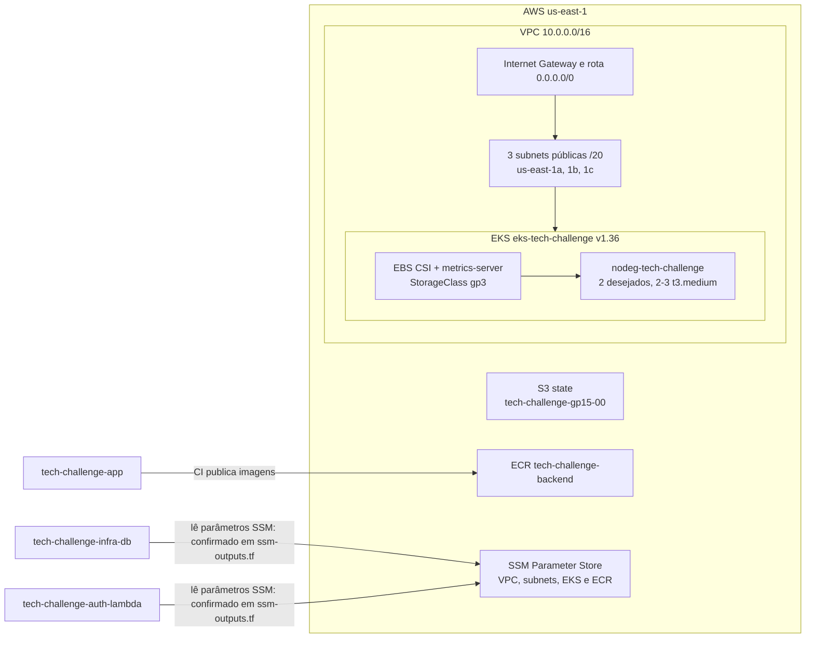

# Tech Challenge — Infra Kubernetes (EKS)

## Propósito

Este repositório contém o Terraform da infraestrutura AWS usada pelo Tech Challenge Fase 3 (Grupo 15, Pós FIAP/SOAT): rede, cluster Kubernetes gerenciado Amazon EKS e repositório ECR. Os manifests Kubernetes aqui são os componentes de plataforma; os manifests da aplicação ficam no repositório `tech-challenge-app`.

O ecossistema informado para o projeto tem quatro repositórios:

| Repositório | Responsabilidade no ecossistema |
|---|---|
| `tech-challenge-infra-k8s` (este) | VPC, EKS, ECR e add-ons de cluster |
| `tech-challenge-infra-db` | Infraestrutura do banco de dados gerenciado |
| `tech-challenge-auth-lambda` | Lambda de autenticação por CPF e API Gateway |
| `tech-challenge-app` | API Java/Spring Boot, executada no EKS, e documentação em `docs/` |

## Tecnologias

- Terraform (constraint do projeto `>= 0.13`; workflow fixa `1.9.8`)
- AWS: VPC, subnets, Internet Gateway, route table, Security Group, EKS, ECR, S3 e SSM Parameter Store
- Providers Terraform `hashicorp/aws`, `gavinbunney/kubectl` e `hashicorp/kubernetes`
- EKS add-on `aws-ebs-csi-driver`, manifest do metrics-server `v0.9.0` e StorageClass `gp3`
- GitHub Actions para plan, apply e destroy da infraestrutura

## Diagrama da arquitetura



Detalhes confirmados da infraestrutura de produção (o diagrama representa este ambiente):

- Região `us-east-1`; VPC `10.0.0.0/16` com DNS hostnames e DNS support habilitados.
- Três subnets públicas com IP público automático: `10.0.0.0/20` em `us-east-1a`, `10.0.16.0/20` em `us-east-1b` e `10.0.32.0/20` em `us-east-1c`; conectadas à rota padrão pelo Internet Gateway.
- Cluster `eks-tech-challenge`, Kubernetes `1.36`, modo de autenticação `API`.
- Node group `nodeg-tech-challenge`: tipo `t3.medium`, mínimo 2, desejado 2 e máximo 3 nós.
- ECR `tech-challenge-backend`: tags mutáveis, scan ao publicar e lifecycle que mantém as 5 imagens mais recentes.
- Backend remoto S3: bucket `tech-challenge-gp15-00`, chave `terraform/terraform.tfstate`, região `us-east-1`. O bucket é preexistente e não é gerenciado por este Terraform.
- Cluster e node group usam a role `LabRole` na conta AWS corrente. Este projeto não cria roles próprias nem configura IRSA/OIDC.

### Acesso ao cluster

O cluster usa autenticação EKS pela API. `access_entry.tf` concede acesso à role `voclabs` da conta corrente por uma Access Entry do tipo `STANDARD`, associa os grupos Kubernetes `group-user` e `group-admin` e vincula a política `AmazonEKSClusterAdminPolicy` no escopo do cluster. Os providers Kubernetes usam o endpoint e o token obtidos por `data.tf`. O node group usa separadamente a role `LabRole`.

### Parâmetros SSM

Publicados por [`ssm-outputs.tf`](ssm-outputs.tf):

| Nome | Tipo | Valor publicado |
|---|---|---|
| `/tech-challenge/vpc_id` | `String` | ID da VPC criada |
| `/tech-challenge/vpc_cidr` | `String` | CIDR da VPC |
| `/tech-challenge/subnet_ids` | `StringList` | IDs das três subnets públicas |
| `/tech-challenge/eks_cluster_name` | `String` | Nome do cluster EKS |
| `/tech-challenge/ecr_repository_name` | `String` | Nome do repositório ECR |

Em homologação, os cinco parâmetros usam o prefixo `/tech-challenge-homolog/`.

`data.tf` não lê parâmetros SSM. Ele consulta a identidade AWS corrente e os dados/autenticação do cluster EKS; os repositórios irmãos indicados em `ssm-outputs.tf` são os consumidores desses parâmetros.

## Passos de execução e deploy

### Pré-requisitos e variáveis

- Terraform; para reproduzir o workflow, use `1.9.8`.
- AWS CLI autenticado com credenciais temporárias/permissões para os recursos necessários.
- A role `LabRole` deve existir na conta usada; a role `voclabs` deve estar disponível para o acesso definido em `access_entry.tf`.
- O bucket de backend S3 deve existir antes de `terraform init`.

Os valores padrão são declarados em [`vars.tf`](vars.tf): `aws_region=us-east-1`, `project_name=tech-challenge`, `environment=production`, `cidr_vpc=10.0.0.0/16`, `instance_types=["t3.medium"]`, `node_min_size=2`, `node_desired_size=2`, `node_max_size=3` e `tags={Name="tech-challenge"}`. Não há `terraform.tfvars.example`, mas há configurações versionadas em [`environments/production.tfvars`](environments/production.tfvars) e [`environments/homolog.tfvars`](environments/homolog.tfvars), selecionadas com `-var-file`.

O workflow define `AWS_REGION=us-east-1` e usa os GitHub Secrets `AWS_ACCESS_KEY_ID`, `AWS_SECRET_ACCESS_KEY` e `AWS_SESSION_TOKEN` para autenticar na AWS. Esses secrets são credenciais do provider, não valores de variáveis Terraform definidos por este workflow. Nenhum valor secreto é documentado aqui.

### Bootstrap do backend (uma vez)

O bucket indicado em [`backend.tf`](backend.tf) precisa ser criado fora do Terraform. Se ainda não existir e o nome estiver disponível na AWS, use a sessão AWS já configurada. Nomes de buckets são globalmente únicos; se precisar escolher outro, ajuste também `backend.tf`. O recurso não é gerenciado pelo Terraform porque o AWS Academy bloqueia a leitura de object lock (`GetBucketObjectLockConfiguration`), conforme documentado nesse arquivo.

```bash
aws s3api create-bucket --bucket tech-challenge-gp15-00 --region us-east-1
aws s3api put-bucket-versioning --bucket tech-challenge-gp15-00 --versioning-configuration Status=Enabled
aws s3api put-bucket-encryption --bucket tech-challenge-gp15-00 --server-side-encryption-configuration '{"Rules":[{"ApplyServerSideEncryptionByDefault":{"SSEAlgorithm":"AES256"}}]}'
aws s3api put-public-access-block --bucket tech-challenge-gp15-00 --public-access-block-configuration BlockPublicAcls=true,IgnorePublicAcls=true,BlockPublicPolicy=true,RestrictPublicBuckets=true
```

### Ciclo local

Na raiz deste repositório, com as credenciais AWS e o bucket prontos:

```bash
terraform init -backend-config=environments/production.s3.tfbackend
terraform plan -var-file=environments/production.tfvars
terraform apply -var-file=environments/production.tfvars
```

> **Ambientes:** troque `production` por `homolog` para operar a stack de homologação (nomes com sufixo `-homolog`, parâmetros SSM em `/tech-challenge-homolog/*`, state em outra key do mesmo bucket). Ao alternar entre ambientes na mesma pasta, rode `terraform init -reconfigure -backend-config=...`.

Homologação usa VPC `10.1.0.0/16`, node group com mínimo 1, desejado 2 e máximo 2 nós `t3.medium`, cluster `eks-tech-challenge-homolog` e ECR `tech-challenge-homolog-backend`. Sua chave de state é `homolog/infra-k8s/terraform.tfstate`; produção usa `terraform/terraform.tfstate`.

Para configurar o `kubectl` após criar o cluster, execute o comando exibido por `terraform output configure_kubectl`. O output `ecr_repository_url` mostra o endereço do ECR e `terraform output docker_build_and_push` exibe comandos para build e publicação manual de uma imagem.

Para remover os recursos gerenciados:

```bash
terraform destroy -var-file=environments/production.tfvars
```

O backend S3 permanece fora do state gerenciado por este projeto. EKS e nós podem gerar custos enquanto existirem.

## Pipeline CI/CD

O workflow [`terraform.yml`](.github/workflows/terraform.yml) é acionado por `push` e `pull_request` para `main` e `homolog`, ou por `workflow_dispatch`, que oferece `plan`, `apply` e `destroy`. A branch `main` seleciona produção e `homolog` seleciona homologação; em PR, vale a branch de destino. Cada ambiente usa seus arquivos em `environments/` para backend e variáveis, com controle de concorrência separado por branch.

1. **Plan:** checkout, configuração das credenciais AWS, setup do Terraform `1.9.8`, `terraform fmt -check -recursive` (com `continue-on-error`), `terraform init` com o backend do ambiente, `terraform validate` e `terraform plan` com o arquivo de variáveis do ambiente. Uma falha no plan faz o job falhar. Em PR, somente este job roda.
2. **Apply:** depende do plan bem-sucedido; executa em push na `main` ou `homolog`, ou dispatch com `action=apply`. Inicializa, aplica com `-auto-approve` e o arquivo de variáveis do ambiente, e mostra os outputs. O job declara o GitHub Environment `production` ou `homolog`, conforme a branch.
3. **Destroy:** depende do plan bem-sucedido e só roda por dispatch com `action=destroy`, no ambiente da branch escolhida. Executa `terraform destroy -auto-approve` com o arquivo de variáveis do ambiente e targets derivados do state; o script exclui endereços que começam com `module.state_bucket`.

Os jobs usam os secrets `AWS_ACCESS_KEY_ID`, `AWS_SECRET_ACCESS_KEY` e `AWS_SESSION_TOKEN`. As credenciais temporárias do AWS Academy expiram e precisam ser atualizadas periodicamente.

<!--
## Fluxo de branches

- O workflow confirma execução em push e PR para `main` e `homolog`; apply roda automaticamente em push após o plan, e PR executa somente plan.
- `workflow_dispatch` permite solicitar `plan`, `apply` ou `destroy` manualmente.
- A `main` é protegida e exige PR; essas regras não são configuradas pelo workflow e precisam ser confirmadas nas configurações do GitHub.
- Deploy de homologação: push na branch `homolog` ou dispatch nessa branch.
- Os jobs de apply e destroy declaram o Environment `production` ou `homolog`, mas regras de aprovação: [AJUSTAR].
-->

## Links

- Swagger local: <http://localhost:8080/swagger-ui.html>
- Coleções [Postman](postman/): [acompanhamento](postman/acompanhamento.collection.json), [atendimento](postman/atendimento.collection.json), [estoque](postman/estoque.collection.json) e [coleção completa](postman/Tech-Challenge-Completa-Production.collection.json).
- `docs/` (ADRs, RFCs e diagramas): repositório [`tech-challenge-app`](https://github.com/postech-grupo-16/tech-challenge-app)
- [`tech-challenge-infra-db`](https://github.com/postech-grupo-16/tech-challenge-infra-db)
- [`tech-challenge-auth-lambda`](https://github.com/postech-grupo-16/tech-challenge-auth-lambda)
- [`tech-challenge-app`](https://github.com/postech-grupo-16/tech-challenge-app)

## Ordem de execução entre repositórios

1. Aplicar `tech-challenge-infra-k8s` para criar VPC, subnets, EKS e ECR no ambiente escolhido. Este repositório publica no SSM os cinco parâmetros listados acima, com prefixo correspondente ao ambiente.
2. `tech-challenge-infra-db` e `tech-challenge-auth-lambda` podem consumir os parâmetros de rede publicados, conforme documentado em `ssm-outputs.tf`; a ordem entre esses dois repositórios: 'tech-challenge-infra-db' depois 'tech-challenge-auth-lambda'.
3. `tech-challenge-app` contém a API e seus manifests.